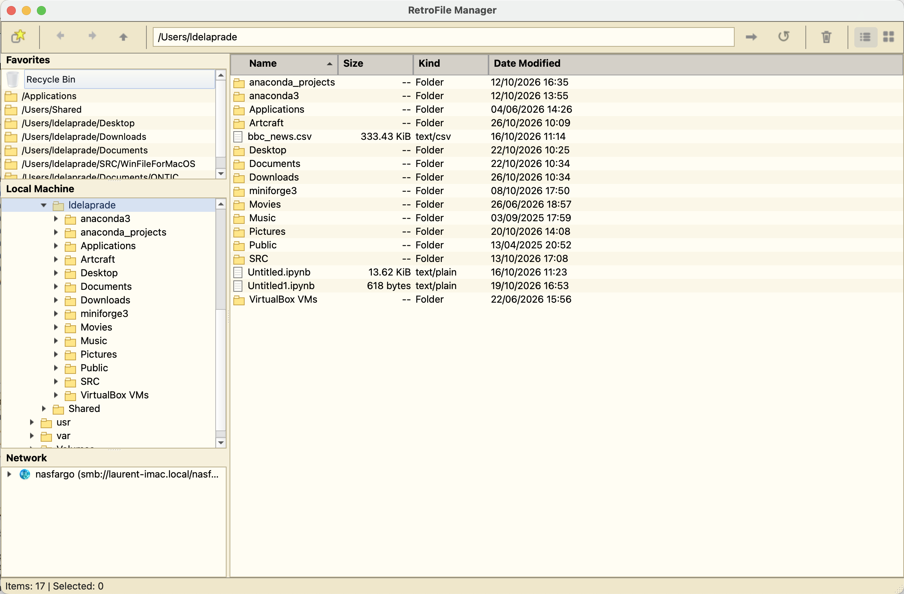
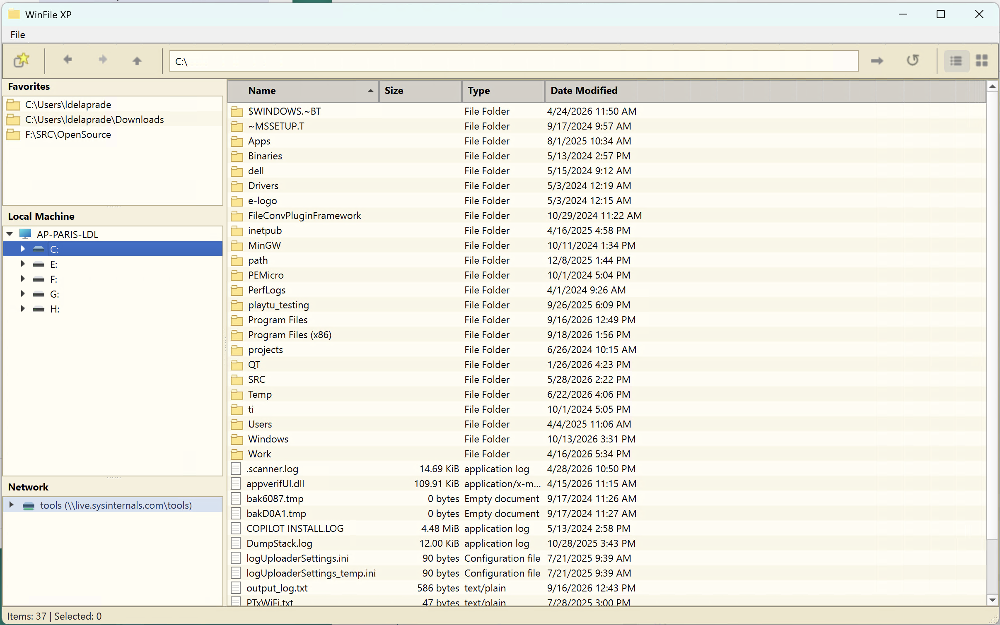
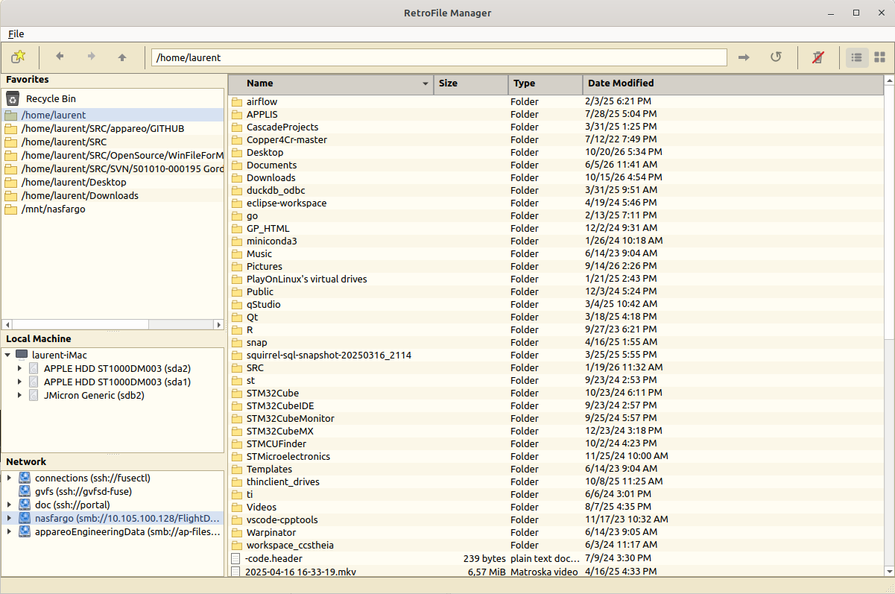

# WinFileForMacOS
## Windows Style Alternative For MacOS Finder (but with Windows and Linux versions as well)

### On MacOS


### On Windows



### On Linux


# WinFile XP (Starter)

A minimal Windows XP-style file explorer starter for macOS using Python and PySide6.

## Included in this starter

- Dual-pane layout (folder tree on left, details list on right)
- Sidebar sections: Favorites, File System, Network
- Navigation toolbar (Back, Forward, Up, address bar)
- Status bar (item count and selected size)
- Context menu operations (Open, Rename, Delete, New Folder, Refresh)
- Drag-and-drop move between folders
- Drag selected files out to external apps and web upload drop zones
- Browse SMB / Samba / NFS network shares via a permanent **Network** node in the left panel
- Shortcuts: `F2` rename, `Delete` remove, `F5` refresh, `Alt+Left/Right` back/forward, `Alt+Up` or `Backspace` parent, `Ctrl+A` select all, `Enter` open, `Ctrl+C/X/V` copy-cut-paste, `Alt+D` or `Ctrl+L` focus path
- Right pane supports multi-selection for bulk move/delete
- Favorites are persisted across launches (bookmarks are restored on startup)
- Favorites can be re-ordered by drag-and-drop
- Git context menu: repository status, stage/unstage selected items, staged diffs, commits, and repository initialization

## Requirements

- Python 3.10+
- Git installed and available on `PATH` for Git operations (also required for packaged applications)

## Run

```bash
python3 -m venv .venv
source .venv/bin/activate
pip install -r requirements.txt
python -m src.main
```

## Notes

- This is an MVP starter aimed at classic explorer behavior.
- Deletion is permanent in this version (no trash integration yet).
- Drag-and-drop move now asks for confirmation with item count and destination preview.
- Delete confirmation now shows selected item names/count.
- To browse a network share: right-click the **Network** node in the left panel → *Connect Network Share…* and enter a network path. Use SMB URL on macOS/Linux (e.g. `smb://server/share` or `smb://server/share/folder`) and UNC path on Windows (e.g. `\\server\share` or `\\server\share\folder`). Alternatively, type it directly in the address bar and press Enter. On macOS, login prompts may appear and the share then appears under *Network*.
- Already-mounted shares (Windows/Samba/NFS/AFP) appear automatically under *Network* when the app starts.
- Right-click a mounted share under *Network* to **Browse**, **Disconnect**, or connect another share.
- Add a bookmark by dragging a folder from *File System* or *Network* into *Favorites*.
- Right-click a folder in *File System* or *Network* and choose **Add to Favorites**.
- On first launch, *Favorites* is pre-populated with Home, Desktop, and Downloads (if they exist).

## Git Integration

Right-click in the file pane and open **Git**. Repository actions use the repository
containing the current folder, including when browsing a subfolder. **Staging...**
and **Unstaging...** are available without selecting files in the explorer.
**Staging...** lists repository-wide **Modified Files** and **Untracked Files** in
separate sections: check files and click **Stage**. **Unstaging...** lists staged
files with their boxes checked: uncheck files and click **Unstage** to remove them
from staging. **Close** leaves the index unchanged. Unstaging preserves working
files, including before the first commit. **View Staged Changes** shows the changes
that **Commit Staged Changes** will commit; other working changes are not included.

**Repository Status** includes **Push**, **Pull**, and **Close** buttons. Push and
Pull use the repository's configured remote and upstream branch; configure these
with Git first (for example, `git push --set-upstream origin <branch>`). Pull is
fast-forward-only and refuses divergent history rather than creating a merge.
Commands use existing Git authentication without terminal credential prompts,
and display their output or errors in a dialog.

**Initialize Repository Here** creates a repository in the current folder after
confirmation, but refuses folders already inside a repository. Git commands run
in a background worker. Missing Git, repository errors, hook failures, and missing
commit identity are reported in a dialog. Configure identity with `git config
--global user.name "Your Name"` and `git config --global user.email "you@example.com"`.

This initial increment uses GitPython and standard Git, without hosting-service
APIs. Status overlays, branch management, clone, and standalone fetch are not yet
implemented. No discard, hard-reset, or force-push actions are exposed.

## Build

### Local unsigned app (for personal use)

```bash
make build
```

Outputs `dist/WinFileXP.app`. Drag to `/Applications` or `open dist/WinFileXP.app`.

To package an unsigned DMG without an Apple Developer certific
```bash
make unsigned-dmg
```

This creates `dist/WinFileXP.dmg` using `hdiutil` (or `create-dmg` if installed).

### Trace packaged crashes (recommended when app exits immediately)

Build a console/debug variant and run it from Terminal to see the full traceback:

```bash
make trace-debug
```

This creates `dist/WinFileXP-debug/WinFileXP-debug` with PyInstaller debug logging.
If it still exits, check:

- `build/WinFileXP-debug/warn-WinFileXP-debug.txt`
- `build/WinFileXP-debug/xref-WinFileXP-debug.html`

Builds automatically check `.venv`, `.venv-*`, then `python3` and `python`, skipping
candidates that fail the Python 3.10+ and pip-import checks. An older environment
is not deleted or upgraded. To select an interpreter explicitly, use:

```bash
make build PYTHON=python3
```

You can also set `PYTHON` to a supported virtual environment's interpreter path.

### Ubuntu/Debian installer

On Ubuntu or another Debian-based Linux distribution, build a native `.deb` package:

```bash
make build-deb
sudo apt install ./dist/WinFileXP_1.0.0_amd64.deb
```

The package installs the application under `/opt/WinFileXP` and adds **WinFileXP** to the desktop application menu. Set a different package version when needed:

```bash
make build-deb DEB_VERSION=1.1.0
```

To remove it later:

```bash
sudo apt remove winfilexp
```

### Signed + notarized release (for sharing)

Requirements before running:
1. Apple Developer ID certificate in Keychain
2. Store your App-specific password: `xcrun notarytool store-credentials notarytool-profile`
3. `brew install create-dmg`
4. Edit the top of `Makefile` to set `DEV_ID`, `PROFILE`, `BUNDLE_ID`

```bash
make release
```

This runs: build → sign → dmg → notarize → staple. Outputs `dist/WinFileXP.dmg` ready to share.

## Cleanup

```bash
make clean      # remove Python caches
make clean-all  # also remove build/ and dist/
```

Cleanup supports Windows PowerShell and macOS/Linux. PyInstaller `.spec` files,
source files, and icon resources are preserved by both targets.